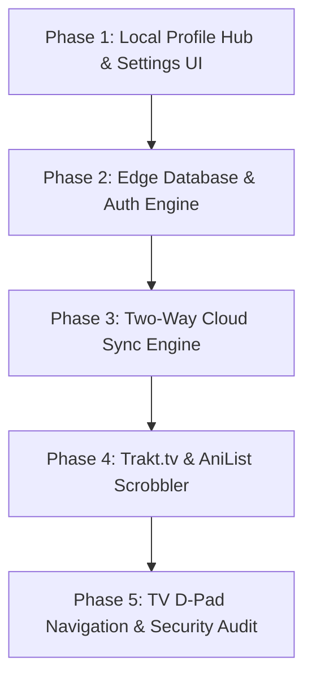

> **Note (2026-10-20):** first draft by another agent, kept for reference. It must be rewritten before any code: see the review points and the decisions in `backlog.md` (G7, G7b, F10).

# Plan: User Accounts, Cloud Sync & External Scrobbling (Trakt/AniList)

**Feature Slug:** `user-accounts-and-cloud-sync`  
**Date:** 2026-10-19  
**Status:** DRAFT / PROPOSED (Pending User Review & Approval)  
**Target Branches:** `feat/user-accounts` -> `master`  
**Scope:** Architecture, Local-First Data Sync, Cloudflare D1 / SQLite Edge Backend, UI Profile Hub, Trakt.tv & AniList Scrobbling.

---

## 1. Executive Summary & Core Philosophy

This feature introduces a comprehensive, modular, and privacy-respecting **User Account and Profile System** to TVZINHA ONLINE.

### Fundamental Architectural Principles
1. **Local-First & Zero Friction (Guest-Friendly):**
   - An account must **NEVER** be mandatory.
   - Anonymous/guest users retain 100% of current functionality via `localStorage` with zero popups or blocking walls.
   - Creating an account seamlessly imports and merges all existing local watch progress and favorites without data loss.
2. **Zero External Heavy Dependencies (Static ESM SPA):**
   - No heavy third-party client SDKs (e.g. Firebase or Supabase client bundles).
   - Pure native ESM modules with standard browser `fetch` and Web Crypto API.
3. **Identical Dual-Environment Parity:**
   - **Production:** Cloudflare Pages with Cloudflare D1 (Serverless SQLite at the edge).
   - **Local Development:** `tools/local_server.py` using Python's standard library `sqlite3` with an identical schema.
4. **Decoupled Scrobbling Pipeline:**
   - External scrobblers (Trakt.tv for Movies/Series, AniList for Anime) operate via a lightweight event-driven adapter (`scrobbler.js`).
   - If an external API is down or rate-limited, it fails completely silently and asynchronously without impacting video playback.

---

## 2. Technical Risk Analysis ("O que pode dar problema")

| Risk / Challenge | Severity | Root Cause | Architectural Mitigation |
| :--- | :--- | :--- | :--- |
| **Data Overwrite on Multi-Device Sync** | High | User watches on Phone and PC concurrently; one device overwrites the other. | **Field-Level Optimistic Concurrency & Union Merges:** Favorites use set unions (never deletions unless explicit). Watch progress uses `Math.max(local.progress, remote.progress)` comparing ISO timestamps. |
| **Cloudflare Pages Stateless Limitations** | Medium | Cloudflare Workers have no persistent RAM or filesystem. | Use Cloudflare D1 (SQLite) with standard HTTP API routes (`functions/api/auth/*` and `functions/api/sync/*`). |
| **Local Development Parity** | Medium | Local server doesn't have Cloudflare D1 bindings. | Python `tools/local_server.py` implements a SQLite handler with identical schema and JSON contract, storing data in `data/local_dev.sqlite`. |
| **OAuth Secret Leakage (Trakt/AniList)** | Critical | `client_secret` exposed in client JS code. | **Backend Token Exchange:** Client opens OAuth popup -> redirects to `/api/integrations/[provider]/callback` -> Backend worker exchanges code with `context.env` secret -> securely stores access token in D1 linked to the user account. |
| **XSS & Session Hijacking** | Critical | Malicious iframe or script injection stealing session tokens. | **HttpOnly, Secure, SameSite=Lax Cookies:** Session tokens are never readable by client JS. Sanitized HTML via `assets/js/core/sanitize.js`. |
| **TV / D-Pad Usability** | Medium | Account and settings modals hard to operate with TV remotes. | Fully integrated into `assets/js/navigation/remote.js` with 2D spatial grid navigation and large focus states. |
| **Storage Quotas & Avatar Bloat** | Low | Custom user image uploads fill database storage. | **Curated Vector/WebP Avatar Gallery:** Zero image upload storage required. Users pick from high-contrast pop-culture/anime avatar presets (or optional Gravatar hash). |

---

## 3. Data Model & Synchronized Entities

### What Gets Connected to the User Account:

1. **Watch Progress & Continue Watching (`progress`):**
   - Shows, Episodes, and Movies.
   - Fields: `content_id`, `type` (`movie`|`series`|`anime`), `season`, `episode`, `position`, `duration`, `finished`, `updated_at`.
2. **Favorites (`favorites`):**
   - Live Channels (channel IDs).
   - Saved Movies, Series, and Animes (TMDB / MAL IDs).
   - Favorite Sports Team (`favorite_team`).
3. **Player Preferences (`preferences`):**
   - `volume` (0..1), `playbackRate` (1, 1.25, 1.5, 2).
   - `quality` (`auto`, `1080`, `720`).
   - `fit` (`contain` | `cover`).
   - `subtitleLanguage` (`pt-BR`, `en`, `off`).
   - `autoSkip` (`true`|`false` - auto-skip intros/outros via AniSkip).
   - `autoNext` (`true`|`false` - auto-play next episode).
4. **UI & Accessibility Preferences:**
   - Channels sidebar width preference.
   - Theme accents (Deep Pine, OLED Pure Black).
5. **External Scrobbler Integrations:**
   - Trakt.tv OAuth tokens & scrobble toggles.
   - AniList OAuth tokens & scrobble toggles.
6. **User Profile Metadata:**
   - Display Name (1–30 chars).
   - Avatar Identifier (e.g. `avatar_cyberpunk_01`, `avatar_anime_zoro`, etc.).
   - Account creation date and stats (total minutes watched, episodes completed).

---

## 4. Architecture & Database Schema

### Database Schema (Cloudflare D1 & Python `sqlite3`)

```sql
-- 1. Users Table
CREATE TABLE IF NOT EXISTS users (
    id TEXT PRIMARY KEY,               -- UUID v4
    email TEXT UNIQUE NOT NULL,        -- Lowercase, indexed
    password_hash TEXT NOT NULL,       -- PBKDF2-HMAC-SHA256
    salt TEXT NOT NULL,                -- 16 bytes hex
    display_name TEXT NOT NULL,
    avatar_id TEXT DEFAULT 'default_1',
    created_at INTEGER NOT NULL,       -- Unix timestamp (seconds)
    updated_at INTEGER NOT NULL
);

-- 2. Sessions Table (Stateless or Token-tracked)
CREATE TABLE IF NOT EXISTS sessions (
    id TEXT PRIMARY KEY,               -- Cryptographic random token
    user_id TEXT NOT NULL REFERENCES users(id) ON DELETE CASCADE,
    expires_at INTEGER NOT NULL,
    user_agent TEXT,
    ip_hash TEXT,                      -- Hashed for privacy
    created_at INTEGER NOT NULL
);

-- 3. Synchronized User Data Blobs
CREATE TABLE IF NOT EXISTS user_sync (
    user_id TEXT NOT NULL REFERENCES users(id) ON DELETE CASCADE,
    category TEXT NOT NULL,            -- 'progress', 'favorites', 'preferences'
    payload TEXT NOT NULL,             -- JSON string
    version INTEGER DEFAULT 1,
    updated_at INTEGER NOT NULL,
    PRIMARY KEY (user_id, category)
);

-- 4. External OAuth Integrations
CREATE TABLE IF NOT EXISTS user_integrations (
    user_id TEXT NOT NULL REFERENCES users(id) ON DELETE CASCADE,
    provider TEXT NOT NULL,            -- 'trakt', 'anilist'
    external_user_id TEXT,
    external_username TEXT,
    access_token TEXT NOT NULL,        -- AES-GCM encrypted or protected
    refresh_token TEXT,
    expires_at INTEGER,
    settings TEXT DEFAULT '{}',        -- JSON toggles (e.g. auto_scrobble: true)
    PRIMARY KEY (user_id, provider)
);
```

---

## 5. UI/UX Design Specifications

### 1. Profile Trigger in Header
- Located at the top right of the viewport (or integrated cleanly next to the floating glass nav capsule).
- Circular frosted glass button (`#header-profile-btn`) displaying:
  - Default: Subtle user SVG icon with glowing emerald ring on hover.
  - Logged In: Selected preset avatar image with active cloud sync indicator dot (🟢 Synced / 🟡 Syncing / 🔴 Offline).

### 2. Settings & Profile Hub (Modal / Slide-out Panel)
- Clean glassmorphism layout following the **Deep Pine Design System** (`01-base.css` tokens: `#060d0b`, `#0e1f1a`, `#00e599`, `rgba(255,255,255,0.06)`).
- Responsive:
  - **Desktop / TV:** Floating centered glass card (`880px` wide, max `85vh`) with left navigation rail and right tab content.
  - **Mobile:** Full-height bottom sheet with native swipe-down or close handle.

#### Tab Structure:
1. 👤 **Perfil (Profile):**
   - Avatar preview with interactive preset picker modal (24 curated pop-culture vector/WebP avatars).
   - Display name editor.
   - Quick stats: *Tempo assistido*, *Episódios concluídos*, *Filmes salvos*.
2. ⚙️ **Preferências (Preferences):**
   - Player defaults: Qualidade inicial, Áudio preferido, Legenda preferida, Pular aberturas automaticamente (AniSkip toggle), Proporção de tela (Ajustar vs Preencher).
3. 🔄 **Conexões (Integrations):**
   - **Trakt.tv Card:** Icon, status badge (Conectado / Não conectado), user handle, button "Conectar com Trakt" / "Desconectar", switch "Auto-scrobble ao reproduzir".
   - **AniList Card:** Icon, status badge, user handle, button "Conectar com AniList", switch "Atualizar episódios de animes automaticamente".
4. 💾 **Sincronização & Backup:**
   - Cloud Sync Status ("Última sincronização: Há 3 minutos").
   - Manual "Sincronizar Agora" button.
   - **Offline Backup Utilities:** "Exportar Backup (JSON)" & "Importar Arquivo de Backup".
5. 🛡️ **Conta & Segurança:**
   - Trocar Senha.
   - Encerrar Sessão (Logout).
   - Excluir Conta (com confirmação dupla e exclusão completa em cascata).

---

## 6. Implementation Phases



### Phase 1: Local Profile Hub & Settings UI (Zero Backend Risk)
- Consolidate settings (`playerPrefs.js` + UI configs + favorites export/import) into a unified UI panel.
- Implement the Profile trigger button on the header.
- Implement the Avatar preset gallery.
- Add local JSON Export / Import functionality (immediate utility for users even before cloud sync is live).
- Verification: 100% frontend, zero regression on existing video playback.

### Phase 2: Edge Database & Auth Engine
- Create database migrations (`tools/schema.sql`).
- Cloudflare Pages backend routes:
  - `POST /api/auth/register`
  - `POST /api/auth/login`
  - `POST /api/auth/logout`
  - `GET /api/auth/me`
- Mirror identically in `tools/local_server.py` using standard `sqlite3`.
- Verification: Automated Python & Node test suites testing password hashing, auth tokens, session expiry, and CORS restrictions.

### Phase 3: Two-Way Cloud Sync Engine (`syncManager.js`)
- Client module `assets/js/core/syncManager.js`.
- Two-way merge algorithm:
  - On Login: Merge local guest `localStorage` with cloud database without overwriting newer records.
  - Background Debounced Sync: Automatically push dirty state 5s after pause, on episode end, or before page unload (`keepalive: true` / Beacon).
- Verification: Multi-tab and multi-browser test simulating offline state and automatic synchronization recovery.

### Phase 4: Trakt.tv & AniList Scrobbler Adapter
- Secure backend OAuth token exchange routes:
  - `/api/integrations/trakt/oauth`
  - `/api/integrations/anilist/oauth`
- Client event listener `assets/js/modules/scrobbler.js`:
  - Listens to `engine.js` playback milestones (Start, 80% Scrobble Milestone, Stop).
  - Trakt.tv Scrobble API for Movies and Series.
  - AniList GraphQL API (`SaveMediaListEntry`) for Anime.
- Verification: Silent failure validation (disconnect internet or mock 500 error from Trakt: video player continues uninterrupted).

### Phase 5: TV D-Pad Navigation & Final Hardening
- Map Spatial D-Pad navigation for the entire Profile & Settings modal in `remote.js`.
- Apply Content Security Policy (CSP) adjustments for Trakt/AniList OAuth popups.
- Run complete browser test suite (`player_ui_check.mjs`, `player_touch_check.mjs`).

---

## 7. Verification & Acceptance Criteria

1. **Local-First Independence:** With no internet connection or with the backend server unreachable, all site features (watching videos, saving favorites, remembering episode progress) work normally using `localStorage`.
2. **Seamless Cloud Merge:** Creating an account merges existing watch history without resetting progress.
3. **Multi-Device Synchronization:** Watching an episode on Device A updates the Continue Watching rail on Device B after refresh or sync.
4. **Security Integrity:**
   - Password hashes use PBKDF2 with unique salts.
   - Sessions use HttpOnly Secure cookies.
   - OAuth client secrets are never sent to the client.
5. **No Regressions:**
   - `python tools/check_js.py` passes with 0 missing imports.
   - `python tools/bump_version.py --check` passes cleanly.
   - All existing automated browser tests pass without errors.
